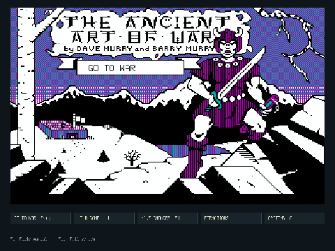
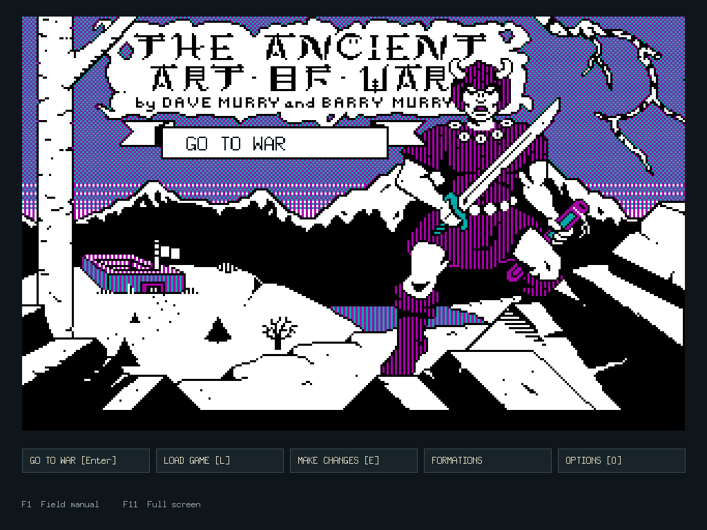
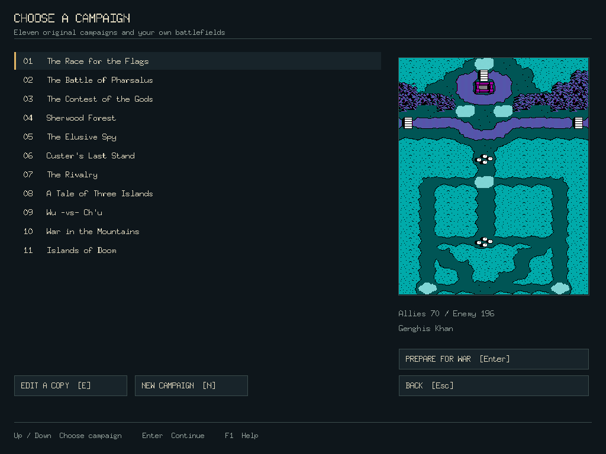
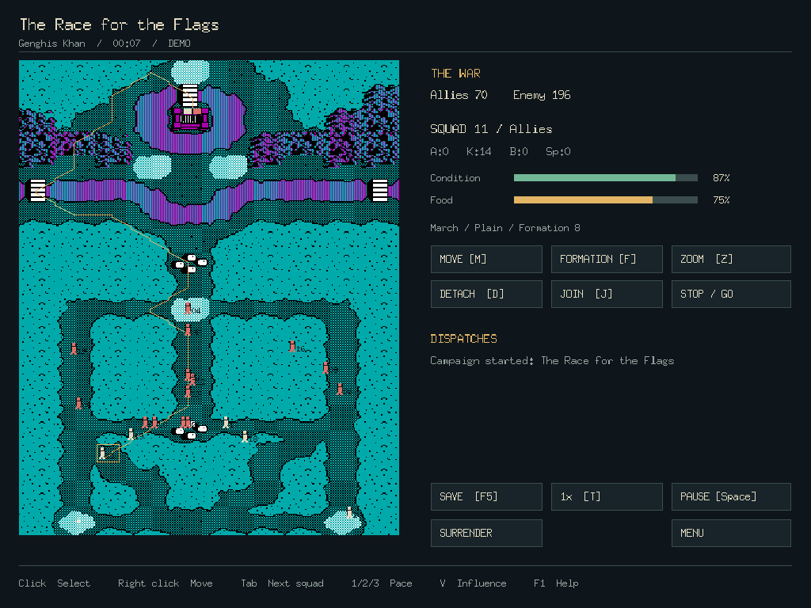
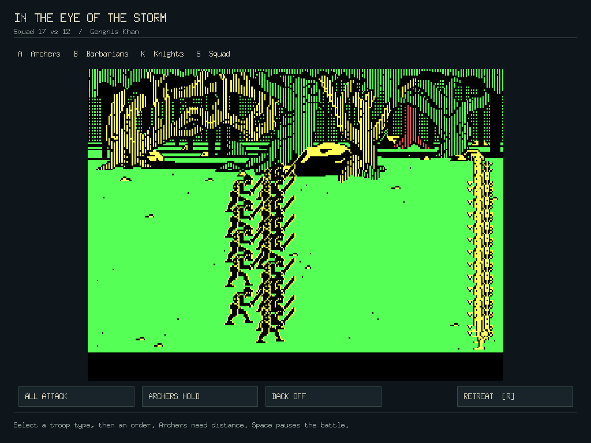
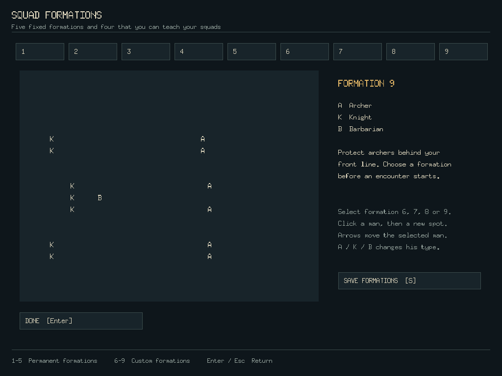
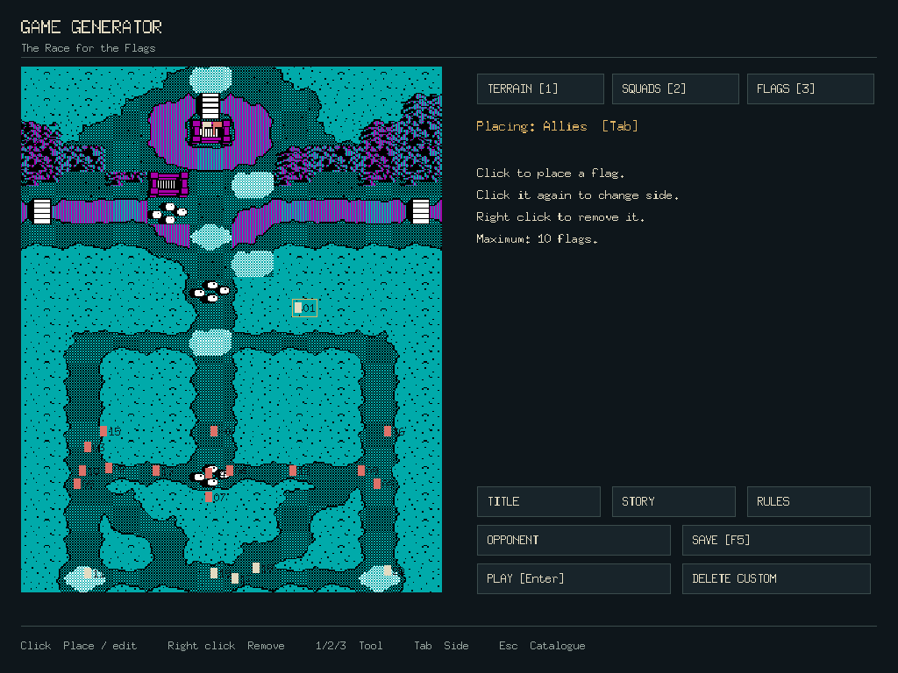
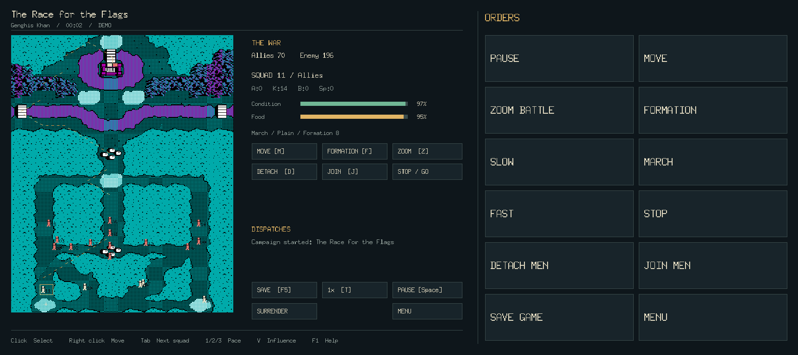

# The Ancient Art of War Go

A native Go/Ebitengine remake of **The Ancient Art of War** for desktop and
Android. Choose from eleven campaigns and eight opponents, command archers,
barbarians, knights and spies, and combine strategic movement with tactical
combat. The game includes nine formations, campaign and formation editors,
custom titles and stories, native saves, mouse and keyboard controls, and an
Android touch interface.



[Watch the full presentation video](media/ancientartofwar-demo.mp4) ·
[WebM version](media/ancientartofwar-demo.webm)

## Desktop

Go 1.26 or newer and a desktop graphics environment are required.
The runtime assets are included; no extraction, preparation or download is
needed before playing.

```sh
go run .
```

Build and run a standalone executable:

```sh
make build
./bin/ancientartofwar
```

Useful launch options:

```sh
go run . -campaign 0           # Start the first campaign immediately (0–10).
go run . -campaign 2 -demo     # Let the computer command both armies.
go run . -touch                # Preview the Android touch controls.
go run . -seed 17              # Select a deterministic game seed.
go run . -save /path/game.json # Select the native save file.
```

Press **F11** to toggle fullscreen mode and **F1** to open the field manual.
The original indexed graphics are presented in a resizable interface. Native
synthesized tones accompany game events.

## Controls

### Strategy and menus

| Input | Action |
| --- | --- |
| Left click | Select a squad or choose a menu command |
| Right click | Give the selected squad a direct route |
| M, clicks or dragging, then M | Draw and confirm a route with waypoints |
| Arrow keys, then Enter | Move the marker and select a squad |
| Tab | Select the next allied squad |
| 1 / 2 / 3 | Set slow, normal or fast marching pace |
| 0 | Stop while retaining the route |
| F | Choose or edit a formation |
| D / J | Detach troops or join/transfer troops |
| Z | Take control of an encounter before automatic combat starts |
| Space | Pause or resume |
| T | Change simulation speed |
| V | Show the influence map |
| F5 / F9 | Save or load a native game |
| F1 | Open the field manual |
| F11 | Toggle fullscreen mode |

### Tactical combat

Press **A** to begin the attack. Select **A**, **B**, **K** or **S** for archers,
barbarians, knights or the entire squad, then use **A**, **B**, **F** or **S** to
attack, fall back, advance or stop. **R** orders a retreat.

Native games are saved to `savegame.json` unless `-save` supplies another path.
Custom campaigns use `campaigns/`, and custom formations use `formations.json`.
Loading a saved game pauses it so you can review the situation before resuming.

## Android

The Android build requires Go 1.26+, Java 17 or 21, Android SDK 36,
Android Build Tools 36.0.0 and Android NDK 28.2.13676358. Set `ANDROID_HOME`
or `ANDROID_SDK_ROOT` when the SDK is not installed in a standard location.

Build the ARM64 debug APK:

```sh
make android
```

Build, install and launch on one authorized USB device:

```sh
make android-run
```

The APK is written to:

```text
android/app/build/outputs/apk/debug/app-debug.apk
```

The landscape interface provides large controls beside the board for menus,
routes, formations, combat, transfers and saves. A touch keyboard supports
custom text. Saves, campaigns and formations use the app's private storage.
After twelve idle seconds in a menu or paused game, an animated knight moves
across a black screen. Touching the screen returns to the previous view.

## Screenshots

| Original title | Campaign selection |
| --- | --- |
|  |  |

| Strategic map | Tactical combat |
| --- | --- |
|  |  |

| Formation editor | Campaign editor |
| --- | --- |
|  |  |

| Android touch controls |
| --- |
|  |

## Original game credits

The original title credits **Dave Murry** and **Barry Murry**.
The Ancient Art of War, its name, artwork and original game data remain the
property of their respective rights holders. This independent remake is not
affiliated with or endorsed by them.
